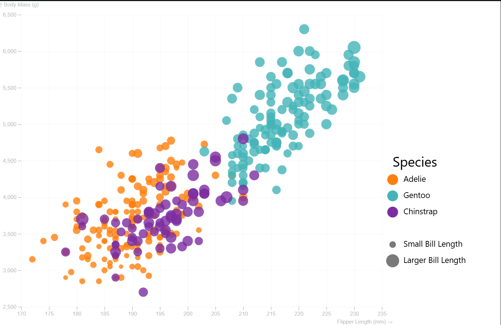
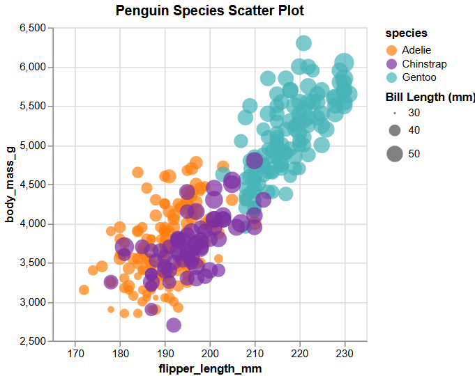
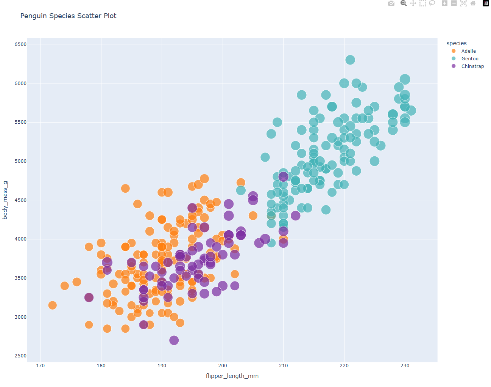

# Anna Towne

## D3
The graph in D3 was done entirely in javascript. It is a popular library that we had experince with last assignment. 

To visualize the dataset I used the svg that can be created with d3 and from there added axises, grad lines, the circles, and a legend by hand. 

I used a documentation and example code from 3 different sites but all were mainly used for understanding syntax. I decided that for this graph I wanted to be able to see the difference in bill length better so the difference in size of the circles is mapped to a larger span to allow viewers to see a more drastic comparison.

## Altair
It is a Python library that is pretty easy to use. Documentation is fairly good, when you want to change things from the basic it gets a little more complex with knowing what funcitons can go in what but overall it made customization pretty easy. 

Also it is super easy to add a hover to get the exact stats of the penguin you are looking at. You can even add things that arn't apart of the visualizaiton like male/female. As long as it is in the dataset.

## Flourish
summary

**IMAGE**

## Plotly
I have used plotly before but it made the graphing process super easy, the documentation is clear and there is a ton of overhead making it a little more complicated to customize. However it makes it really easy to just get a graph with the basics of what you want. It is all in python, and when working with python pandas makes it super easy to clean the data.

Also, while custimization is a bit more complicated, their documentation is incredible and they have a search bar on the side for most things. And if you don't know the exact wording to look it up on the site, I found googling it with plotly documentation sends you to the right area to find the documentation you need. 

Lastly, while there is not a legend on the side for bill length, they are size differently based on size. Also, when you hover over the points it will tell you the exact size.

## ggplot2 (R)
summary

**IMAGE**

---
### Technical Achievements
- words go here
- hopefully more go here

#### Design Achievements
- made stuff a lot prettier by doing xyz

#### Resources Used
- D3 documentaiton
    - Used as base code for d3, overall basic syntax of graphing with d3 was learned from this / documentation
    - https://observablehq.com/@d3/scatterplot-with-shapes
    - https://d3js.org/what-is-d3
    - https://d3-graph-gallery.com/graph/custom_legend.html
- Plotly documentation
    - https://plotly.com/python/line-and-scatter/
- Altair documation
    - https://altair-viz.github.io/user_guide/api.html
